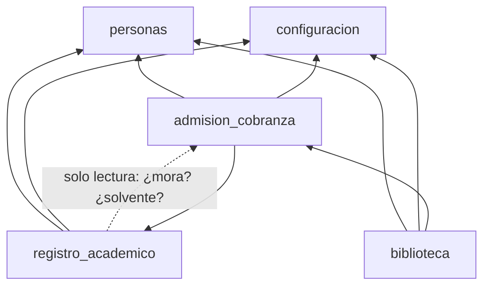
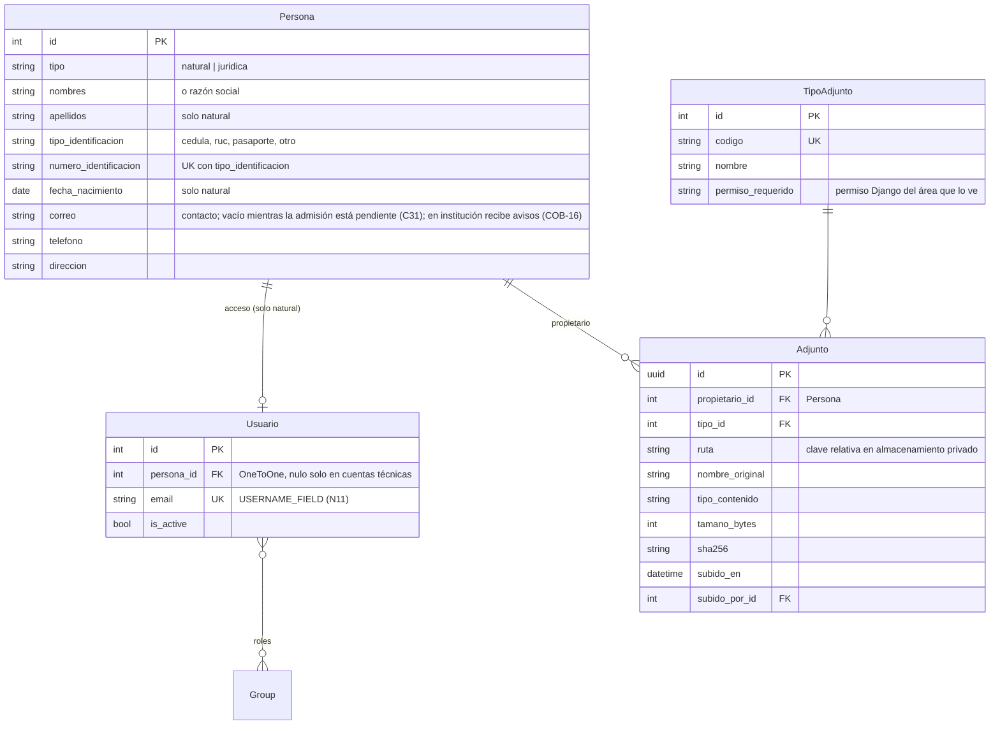
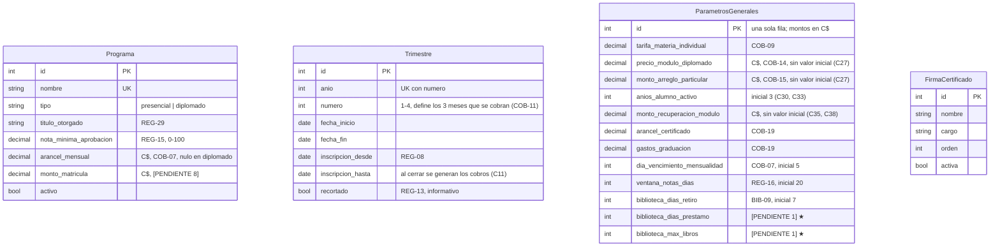
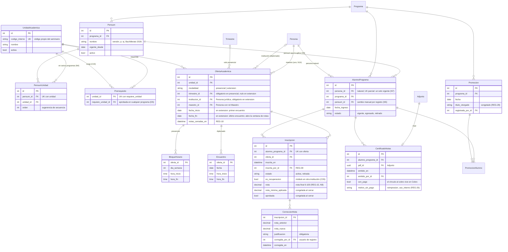
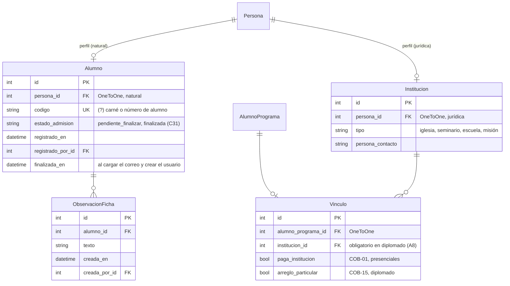
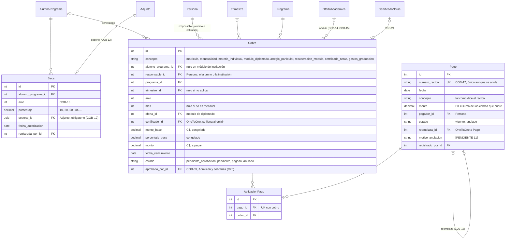
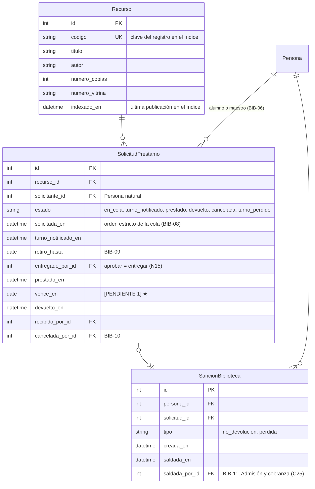

# Modelo de datos inicial (v4, para discusión)

**Estado:** PROPUESTA. Nada de esto es una regla firme hasta que se revise.
**Fecha:** 2026-10-29 (v0: 2026-10-28, v1 a v3: 2026-10-29)
**Fuente:** `.artifacts/shared-understanding-seminario.md` (las reglas se citan por ID) y las respuestas de la revisión (identificadas como A1–A8, N1–N15, B1–B11 y C1–C6 en la sección 4.2).

Este documento propone las entidades, relaciones y dependencias entre apps que se pueden extraer del documento de Shared Understanding. Sirve de base para que se corrija y amplíe antes de escribir el primer `models.py`.

Convenciones del documento:
- Los identificadores van en `snake_case` y sin tildes (`anio`, `numero_recibo`); los nombres visibles y del glosario se mantienen en español.
- `(?)` marca algo que el documento no resuelve. Las preguntas están en la sección 4.
- `[PENDIENTE n]` remite a la sección 10 del documento de negocio. No se diseña la regla, solo se deja el hueco.

## Cambios

### v3 → v4 (respuestas de la ronda 4)

| # | Cambio | Origen |
|---|---|---|
| C32 | Una materia aprobada vale en todo programa: se usa el resultado congelado al cerrar notas, con la mínima del programa donde se cursó. | C1 |
| C33 | `anios_alumno_activo` es configurable, con **3** como valor inicial. Se cuenta desde la fecha de fin de la última clase cursada, aprobada o no. | C2 |
| C34 | Con la admisión pendiente de finalizar, el alumno **puede inscribirse y genera cobros**. Solo espera su usuario. | C3 |
| C35 | Recuperar un módulo en otra institución **genera un cobro al alumno** (`recuperacion_modulo`), aunque su institución lo avale. Es una excepción a favor del alumno. | C4 |
| C36 | Auditoría con **`django-simple-history`**. | C5 |
| C37 | Si la materia requerida no está en el pensum del alumno, el prerrequisito **se ignora**. Al guardar un pensum con esa omisión, registro ve un aviso y debe confirmarla. | C6 |
| C38 | La recuperación tiene **monto propio** (`monto_recuperacion_modulo`) y es el **único** cobro de esa inscripción. Se cobra siempre a la persona, sin importar su vínculo ni si su institución paga. El cobro del intento anterior (no aprobado) se mantiene: ya se cursó. | D1 |

### v2 → v3 (respuestas de la ronda 3)

| # | Cambio | Origen |
|---|---|---|
| C20 | Confirmado: el cobro del módulo vence en su `fecha_fin` y la institución entra en mora un mes después. | B1 |
| C21 | Confirmado: la matrícula se genera **solo** con la primera inscripción del año académico. | B2 |
| C22 | El sistema **no registra horas**. Las gobierna registro al armar horarios y encuentros. Desaparecen `UnidadAcademica.horas` y el aviso de horas del diplomado. | B3 |
| C23 | Los **prerrequisitos son de la materia**, no del pensum: `Prerrequisito` une dos `UnidadAcademica`. | B3 |
| C24 | Un **solo rol de registro**: el grupo "Registro académico". Todo usuario de registro es coordinador. | B5 |
| C25 | "Administración" en lo operativo = **Admisión y cobranza**. El **Administrador** solo actúa a nivel de sistema. | B6 |
| C26 | Desaparece `AnexoPrograma`: la hoja es un formato único que se sube como adjunto. La ficha pide los datos generales (nombre, correo, teléfono, identificación). | B7 |
| C27 | Los montos del diplomado se configuran en córdobas. Los valores en $ del documento **no** se cargan como valores iniciales. | B8 |
| C28 | La sincronización Notion → índice es una **automatización externa**, fuera de este sistema. | B9 |
| C29 | Registro puede inscribir a un alumno de diplomado en un módulo de **otra institución** (para recuperar una materia atrasada o perdida). | B10 |
| C30 | **Alumno activo** = programa vigente y última clase cursada dentro de una ventana configurable (ejemplo: 3 años). | B10 |
| C31 | El correo se crea **fuera del sistema**. La ficha se puede registrar sin correo, con la admisión **pendiente de finalizar**. Al cargar el correo se finaliza: se crea el usuario y se envía un correo de bienvenida. | B11 |

### v1 → v2 (respuestas a las preguntas)

| # | Cambio | Origen |
|---|---|---|
| C8 | Cobro según la carga del trimestre: 0 materias → no se cobra; 1 → tarifa de materia individual; 2 o más → arancel completo del programa. COB-07 y COB-08 son compatibles. | A1 |
| C9 | Cada adjunto lo ve **solo el área que lo agrega**. El alumno nunca ve sus adjuntos. | A2 |
| C10 | `Persona` lleva `tipo_identificacion` y `numero_identificacion` (cédula, RUC, pasaporte u otro). | A3 |
| C11 | Los cobros de un trimestre (tres mensualidades) se generan **juntos**, al cerrar la inscripción. La matrícula se genera con la primera inscripción del año. | A7, N2, N6 |
| C12 | Sin pagos parciales: un recibo cubre uno o varios cobros **completos**. `AplicacionPago` ya no lleva monto. | N2 |
| C13 | Una sola moneda: **córdobas**. Sin campo de moneda ni tipo de cambio. | N3 |
| C14 | `UnidadAcademica` pasa a ser un **catálogo compartido** con el **código interno** del seminario. El pensum la referencia (`PensumUnidad`). Una materia aprobada vale en todo pensum que tenga ese código. | N4 |
| C15 | Una persona tiene **un solo programa vigente** a la vez. "Activo" se **calcula** (inscribió en el año académico). | N6, N7 |
| C16 | Las ofertas de diplomado no tienen trimestre: tienen fechas propias y encuentros. El vínculo con la institución es **obligatorio** en el diplomado. | N8, A8 |
| C17 | **Coordinador de registro** es un rol con las funciones de registro académico. | N12 |
| C18 | Biblioteca: aprobar el préstamo = entregar el libro. El **índice** es la vía de navegación del catálogo, físico y digital. Sin índice no hay vistas de biblioteca. | N15, A5, A6 |
| C19 | Recomendación de inicio de sesión: **correo** (propio o generado por el seminario), no el teléfono. | N11 |

### v0 → v1 (observaciones de la primera revisión)

C1 institución = persona jurídica · C2 adjuntos centralizados con descarga protegida · C3 un solo servicio de acceso · C4 cobranza parte del programa del alumno; el grafo se invierte · C5 `AlumnoPrograma` en registro y `Vinculo` en cobranza · C6 biblioteca solo con recursos físicos · C7 arancel por alumno–programa y mes.

---

## 1. Decisiones estructurales

### D1. Persona (natural o jurídica), usuario y roles

**Persona.** Una sola tabla `Persona` con `tipo`:
- **Natural**: alumnos, maestros y personal.
- **Jurídica**: instituciones.

Identificación con `tipo_identificacion` (cédula, RUC, pasaporte, otro) y `numero_identificacion`. Son obligatorios y el par es único (A3). Los datos propios de cada papel van en perfiles 1:1 de las apps de dominio: `Alumno` (ficha) e `Institucion`.

**Usuario.** `personas.Usuario` hereda de `AbstractUser` y se declara `AUTH_USER_MODEL = "personas.Usuario"` **antes de la primera migración de cualquier app** (hoy no está declarado; hay que recrear la base local).

- `Usuario.persona` es `OneToOne`. Admite nulo solo en cuentas técnicas.
- Una persona jurídica **nunca** tiene usuario (ACC-03). Lo hacen cumplir el servicio de acceso y `clean()`.
- **Inicio de sesión con correo** (C19, N11): `USERNAME_FIELD = "email"`, único.
  - Si el alumno no tiene correo propio, el seminario se lo crea **fuera del sistema** (C31, B11). El sistema no gestiona cuentas de correo.
  - El teléfono queda como dato de contacto, no como usuario. Se recicla, se comparte en familia y no da un canal para recuperar la contraseña sin una integración de SMS o WhatsApp ([PENDIENTE 10]).
  - El correo de inicio de sesión vive en `Usuario` (es una credencial). `Persona.correo` es de contacto, admite vacío mientras la admisión está pendiente y, cuando hay usuario, tiene el mismo valor.
- **Roles = `Group` de Django**: Administrador, Admisión y cobranza, Registro académico, Maestro, Alumno. "Registro académico" es un solo grupo: todo usuario de registro es coordinador (C24, B5).
- **Administrador = nivel de sistema** (C25, B6): configuración, usuarios y roles. Lo que el documento llama "administración" en las operaciones es Admisión y cobranza.
- **Superusuario ≠ rol Administrador.** El superusuario es la cuenta técnica de instalación; el Administrador es un grupo con permisos de configuración.

**Servicio de acceso (TEC-11).** `otorgar_acceso(persona, rol, otorgado_por)`: si la persona no tiene usuario lo crea y envía el acceso; si ya lo tiene, solo le suma el rol (ACC-02, ACC-03). Exige que la persona tenga correo. Se completa con `quitar_rol` y `restablecer_acceso`.

| Quién otorga | Roles que puede otorgar | Regla |
|---|---|---|
| Administrador | Cualquiera | Sección 3 |
| Admisión y cobranza | Solo Alumno, **automáticamente** al finalizar la admisión (C31) | ACC-01, ADM-07 |
| Registro académico | Maestro | ACC-02, REG-07, N12 |

**Admisión en dos pasos (C31, B11).** La ficha se registra aunque la persona aún no tenga correo; queda **pendiente de finalizar**. Cuando admisión carga el correo, `finalizar_admision` llama a `otorgar_acceso(persona, Alumno)` en la misma transacción: crea el usuario y envía un **correo de bienvenida** con las orientaciones y el enlace para fijar la contraseña (ADM-07). Así ACC-01 se cumple sin crear usuarios sin credencial. El envío usa SMTP con credenciales por variables de entorno; el proveedor se define en el despliegue.

**ACC-04:** se mantiene la recomendación de **asignar** el grupo Alumno al registrar la ficha.

### D2. Adjuntos: el archivo fuera de la BD y la descarga detrás de permisos

- La BD guarda la **clave de almacenamiento** (ruta relativa), no una URL. El archivo vive en un directorio **privado**, fuera de la raíz web (TEC-04).
- Una sola vista de descarga, `adjuntos/<uuid>/`:
  1. El servicio verifica el permiso.
  2. Si se concede, el servidor web entrega el archivo (`X-Sendfile` / `X-Accel-Redirect`, se confirma con Webuzo). Si no se puede, Django lo sirve con `FileResponse`.
- Todo adjunto tiene un **propietario** (la persona a la que pertenece) y un **tipo**.
- **Visibilidad (C9, A2):** cada `TipoAdjunto` pertenece a un **área** y solo esa área lo ve. El propietario **no** tiene acceso a sus adjuntos: el alumno no es usuario de esos documentos.

| Tipo de adjunto | Lo agrega | Lo ve | Regla |
|---|---|---|---|
| Cédula / identificación, diploma de bachiller, carta del pastor, hoja de matrícula firmada (formato único para todos los programas, B7) | Admisión | Admisión | ADM-01–04 |
| Convenio, carta de solicitud (institución) | Admisión | Admisión | ADM-05 |
| Soporte de autorización de beca | Admisión y cobranza | Admisión y cobranza | COB-12 |
| Certificado de notas (PDF) | Registro (lo genera) | Registro y admisión (lo descarga e imprime) | REG-22, REG-25 |

El certificado es el único tipo que ven dos áreas, porque REG-25 lo pide.

### D3. Grafo de dependencias entre apps

- **FK y migraciones:** solo en la dirección de las flechas sólidas.
- **Lecturas entre apps:** por `selectores.py` de la app dueña. **Escrituras:** por `servicios.py` de la app dueña.
- **Única excepción hacia arriba** (línea punteada): registro lee de cobranza para MOR-03 / REG-21 (mora al consultar notas) y REG-28 (solvencia y gastos de graduación al promocionar).
- **Cobranza nunca espera un aviso de registro.** Un comando de cron (TEC-05) lee inscripciones y ofertas con los selectores de registro y genera los cobros (sección 2.5). Así ni la matrícula ni las mensualidades obligan a registro a escribir en cobranza.
- Los flujos que cruzan las dos áreas empiezan en cobranza. Ejemplo: "emitir certificado contra un pago" (REG-24). El botón puede estar en la pantalla de registro.

### D4. Catálogos compartidos en `configuracion`

`Programa` (arancel en córdobas, nota mínima, título) y `Trimestre` viven en `configuracion`. Los parámetros globales van en `ParametrosGenerales`. El grupo Registro académico recibe permiso para editar `Trimestre` (REG-04).

### D5. La materia es un catálogo con el código interno del seminario

Cambia con N4: el seminario identifica cada clase con un **código interno propio**, y la misma clase puede estar en bachillerato, profesorado, licenciatura y diplomado.

- `UnidadAcademica` es el **catálogo** (código interno único, nombre). Sigue siendo una sola entidad para materia y módulo.
- `PensumUnidad` dice qué unidades tiene cada pensum.
- **La aprobación es de la persona con el código, no del programa.** "¿Aprobó X?" se responde buscando una inscripción aprobada de esa persona con esa unidad, en cualquier programa. Vale para prerrequisitos (REG-02), para el cumplimiento del pensum y para la promoción (REG-28).
- Esto **no** es una convalidación (REG-03): es la misma materia.
- **Prerrequisitos de la materia** (C23, B3): "Exégesis de Romanos exige Principios de Exégesis" vale en todo programa que tenga las dos. Si el pensum del alumno **no** incluye la materia requerida, la exigencia se ignora para él (C37). Para que esa omisión sea una decisión y no un descuido, al guardar el pensum registro ve la lista de prerrequisitos que quedan fuera y debe confirmarla; la confirmación queda en el historial (C36).
- **Sin horas** (C22, B3): el sistema no las guarda ni las valida.
- **Nota mínima por programa** (REG-15, B4), en `configuracion`. Al cerrar notas se congela la mínima del programa donde se cursó y el resultado (`aprobada`). Ese resultado vale tal cual en cualquier otro programa, aunque su mínima sea más alta (C32): `aprobo(persona, unidad)` lee `aprobada`, no recalcula.

### D6. Cobro (obligación) ≠ Pago (registro del recibo)

- **`Cobro`**: lo que se debe. Lo genera el cron a partir de inscripciones y ofertas, o admisión a pedido (certificado, gastos de graduación).
- **`Pago`**: el recibo oficial manual (COB-17), anulable y reemplazable (COB-18). Cubre **uno o varios cobros completos** (N2): `monto` del pago = suma de los cobros que cubre.
- **`AplicacionPago`**: qué cobros cubre cada pago. Se conserva aunque el pago se anule, así queda la historia de lo que cubría el recibo anulado.
- Un cobro puede tener **a lo sumo una aplicación con un pago vigente**. Lo valida el servicio de pagos.
- Todo en **córdobas** (N3). El tipo de cambio, si lo hay, lo resuelve la persona fuera del sistema.

### D7. Estados derivados, con instantáneas donde importa

- Se **calculan**:
  - La mora.
  - El estado de aprobado.
  - Las copias disponibles.
  - Si el alumno está **activo** (C30).
- Se **congelan** en el momento del hecho:
  - El monto y el % de beca en el `Cobro`.
  - La nota mínima y el resultado al cerrar notas.
  - El título en la `Promocion`.
- **Excepción:** `Cobro.estado` se guarda, porque la vista de pagos pendientes (COB-20) lo consulta mucho. Lo cambia **solo** el servicio de pagos, en la misma transacción que crea o anula el pago.

---

## 2. Entidades por app

### 2.1 `personas`

| Entidad | Para qué | Reglas |
|---|---|---|
| `Persona` | Identidad natural o jurídica, contacto. | ACC-03, A3 |
| `Usuario` | Acceso con correo. Solo personas naturales. | ACC-01–03, N11 |
| `Group` (Django) | Roles. | Sección 3, N12 |
| `TipoAdjunto` | Catálogo de tipos, con el permiso del área que los ve. | D2, A2 |
| `Adjunto` | Archivo en almacenamiento privado, de una persona. | TEC-04, D2 |

### 2.2 `configuracion`

### 2.3 `registro_academico`

| Entidad | Para qué | Reglas |
|---|---|---|
| `UnidadAcademica` | **Catálogo** de materias y módulos con el código interno del seminario. | N4, D5 |
| `Pensum` | Plan de un programa. Puede haber varias versiones. | REG-01, N5 |
| `PensumUnidad` | Unidad que forma parte de un pensum. | REG-01, N4 |
| `Prerrequisito` | La unidad A exige la B **aprobada**, en todo programa (C23). | REG-02, REG-10, B3 |
| `AlumnoPrograma` | La persona en su programa, con el pensum que le aplica. **Un solo programa vigente por persona.** | N5, N7, REG-27 |
| `OfertaAcademica` | Una unidad que se imparte. Presencial: en un trimestre, con horario. Diplomado: en una institución, con fechas y encuentros propios. Un maestro por oferta. | REG-05–07, N8, N14 |
| `BloqueHorario` | Horario sabatino de una oferta presencial. | REG-11, REG-14 |
| `Encuentro` | Fecha y horas de un encuentro de diplomado (1, 2, 4 o los que se acuerden). | REG-06, N8 |
| `Inscripcion` | Alumno–programa + oferta, con **una sola nota final**. | REG-08–12, REG-15, REG-19, N9 |
| `CorreccionNota` | Corrección posterior al cierre, con justificación (la hace registro). | REG-18, N12 |
| `CertificadoNotas` | PDF emitido (`Adjunto`), con pago o con motivo. | REG-22–26 |
| `Promocion` / `PromocionAlumno` | Acto de certificación y sus alumnos. | REG-27–30 |

**Restricciones y validaciones:**
- **N7 (un programa a la vez):** `UniqueConstraint(persona, condition=estado="vigente")`. Que la misma persona sea maestro es solo un rol más.
- **Modalidad:** `CheckConstraint` en `OfertaAcademica`. Una oferta presencial tiene trimestre y no tiene institución; una de extensión, al revés.
- **Al inscribir:**
  - La unidad debe estar en el pensum del alumno.
  - Los prerrequisitos de la materia deben estar aprobados (por código, D5, C23), salvo los que no están en el pensum del alumno (C37).
  - No puede haber choque de horario en el trimestre (REG-11, presencial).
  - En diplomado, la oferta **puede** ser de otra institución distinta a la del vínculo (C29, B10). Es la vía para recuperar un módulo atrasado o perdido. Se marca como recuperación y genera un cobro al alumno (C35, sección 2.5).
- **Al guardar un pensum:** aviso con los prerrequisitos de sus materias que no están en el pensum; se guarda solo si registro lo confirma (C37).
- **REG-26:** `CheckConstraint`: `con_pago` **o** `motivo_sin_pago`.
- **REG-30:** la ficha muestra el título a partir de `PromocionAlumno`.
- **La oferta no pertenece a un programa:** puede inscribirse cualquier alumno cuyo pensum tenga esa unidad. Si una clase no se debe compartir entre programas, se crean ofertas separadas.

**Alumno activo (C30, B10):** el alumno cuyo `AlumnoPrograma` está `vigente` y cuya última clase cursada (la `fecha_fin` más reciente de sus ofertas inscritas) cae dentro de los últimos `anios_alumno_activo` años (inicial 3, configurable; cuenta aunque la materia no se haya aprobado, C33). Así, quien terminó el pensum el año anterior sigue activo para promocionarse (REG-27). Se calcula; no se guarda una bandera que alguien olvide actualizar.

Selectores que expone: `inscripciones_del_trimestre(trimestre)`, `materias_inscritas(alumno_programa, trimestre)`, `primera_inscripcion_del_anio(alumno_programa, anio)`, `ofertas_de_extension(desde, hasta)`, `inscritos(oferta)`, `aprobo(persona, unidad)`, `alumnos_activos(programa)`.

### 2.4 `admision_cobranza`: admisión

| Entidad | Para qué | Reglas |
|---|---|---|
| `Alumno` | La ficha: perfil 1:1 de una persona natural, con su estado de admisión. | ADM-01, ACC-01, C31 |
| `Institucion` | Perfil 1:1 de una persona jurídica. | ADM-05, COB-03 |
| `Vinculo` | Alumno–programa ↔ institución, "paga la institución" y arreglo particular. **Obligatorio en diplomado** (A8). | ADM-06, COB-01–04, COB-15 |
| `ObservacionFicha` | Notas manuales en la ficha. | Sección 5 |

**Vínculo según el programa:**
- **Presenciales:** el vínculo es opcional y solo existe si hay patrocinio (COB-03).
- **Diplomado:** el vínculo siempre existe, porque el módulo se imparte en la institución (A8). Si el alumno tiene arreglo particular, sigue vinculado, pero paga su parte directamente. Recuperar un módulo en otra institución no cambia el vínculo (C29).

**Admisión pendiente (C31):** mientras `estado_admision = pendiente_finalizar`, la persona no tiene usuario. La ficha muestra el aviso "falta el correo" y una lista de admisiones pendientes permite darles seguimiento. En ese estado el alumno sí se inscribe y genera cobros (C34); como no tiene usuario, todavía no consulta notas ni biblioteca.

### 2.5 `admision_cobranza`: cobranza

| Entidad | Para qué | Reglas |
|---|---|---|
| `Beca` | % autorizado por el presidente, con soporte (`Adjunto`), por año. | COB-12, COB-13, [PENDIENTE 4] |
| `Cobro` | Obligación de pago, en córdobas. | COB-05–11, COB-14, COB-15, COB-19 |
| `Pago` | Recibo oficial manual; cubre uno o varios cobros completos. | COB-17, COB-18, N2 |
| `AplicacionPago` | Qué cobros cubre cada pago. | N2, D6 |

**Generación de cobros:** un comando de cron (TEC-05, por ejemplo `generar_cobros`) que se puede correr todos los días sin duplicar nada. Cada cobro tiene una clave natural única: alumno–programa, concepto, año, mes y oferta, según corresponda.

1. **Cobros del trimestre** (presenciales). Cuando cierra la inscripción del trimestre (`inscripcion_hasta`), para cada `AlumnoPrograma` con inscripciones en ese trimestre:
   - **1 materia:** tres cobros `materia_individual` en `pendiente_aprobacion`, con la tarifa de `ParametrosGenerales`, y un aviso para que Admisión y cobranza lo apruebe (COB-09, REG-12, C25).
   - **2 o más:** tres cobros `mensualidad` con el `arancel_mensual` del programa, menos la beca del año (COB-13, C8).
   - **0 materias:** no se genera nada (COB-08).
   - Los tres meses se generan **juntos**, con vencimiento el día configurado de cada mes (COB-07). Se cobran aunque el trimestre esté recortado (COB-11).
   - **Efectos:** un recibo puede cubrir los tres meses (N2). El pago anticipado queda limitado al trimestre en curso sin programar nada, porque los cobros de trimestres futuros todavía no existen (COB-10, [PENDIENTE 6]).
2. **Matrícula** (presenciales). **Solo** la primera inscripción del año académico genera un cobro `matricula` por año y alumno–programa (COB-05/06, A7, C21). La admisión no la genera. El cron lo detecta con `primera_inscripcion_del_anio`. Si se quiere que salga en el mismo momento de la inscripción y no al día siguiente, se ejecuta una vez el generador al terminar la inscripción.
3. **Módulo de diplomado:** por cada oferta de extensión, un cobro `modulo_diplomado` a la institución que lo aloja (COB-14) y un cobro `arreglo_particular` por cada inscrito con esa marca que no esté en recuperación (COB-15), y un cobro `recuperacion_modulo` **al alumno** por cada inscripción de recuperación, aunque su institución pague (C35, C38). Es el único cobro de esa inscripción. El responsable es siempre la persona del alumno, así que cuenta para su mora. Si la institución le da el dinero, es un asunto entre ellos. El cobro del intento anterior, no aprobado, no se anula ni se ajusta. Vencen en la `fecha_fin` del módulo, y la mora de la institución empieza un mes después (COB-16, C20). Si los montos no están configurados en C$, el comando no genera esos cobros y avisa (C27).
4. **Certificado y gastos de graduación:** se crean en admisión a pedido (COB-19).

**Responsable del cobro:** la persona de la institución si `Vinculo.paga_institucion`; si no, la persona del alumno (COB-01/02). En el módulo de diplomado, siempre la institución; en la recuperación de un módulo, siempre el alumno (C35).

**Mora del alumno (MOR-01):** cobros vencidos cuyo responsable es la persona del alumno. Por construcción, la mora de una institución nunca bloquea a sus alumnos (COB-16). El punto de partida del mes sigue en [PENDIENTE 5].

Selectores que expone: `esta_en_mora(persona)`, `esta_solvente(alumno_programa)`, `gastos_graduacion_pagados(alumno_programa)`, `cobros_certificado_disponibles(alumno_programa)`, `pagos_pendientes()` (COB-20).

### 2.6 `biblioteca` (solo recursos físicos en la BD)

| Entidad | Para qué | Reglas |
|---|---|---|
| `Recurso` | Ficha de un título **físico**. | BIB-03 |
| `SolicitudPrestamo` | Ciclo: en cola → turno notificado → prestado (aprobar = entregar, N15) → devuelto, o cancelada o turno perdido. | BIB-06–10, BIB-12 |
| `SancionBiblioteca` | No devolución o pérdida; bloquea nuevos préstamos hasta que se salda. | BIB-11, [PENDIENTE 2] |

**El índice como vía de navegación (A5).** Las vistas de biblioteca buscan y navegan **sobre el índice** (Algolia u otro, TEC-08), que reúne dos fuentes:
- **Físicos:** Django publica en el índice cada alta o cambio de `Recurso`. Lo hace el servicio de biblioteca después de guardar, o un comando de cron que revisa `indexado_en`.
- **Digitales:** desde Notion, sin pasar por la BD (C6), con una **automatización externa** que no es parte de este sistema (C28, B9). Este sistema no guarda ni necesita credenciales de Notion.

Se recomienda que el índice guarde solo datos de catálogo, que casi no cambian. La **disponibilidad de copias y la solicitud de préstamo** se consultan a Django al abrir el detalle de un recurso físico. Si la disponibilidad viviera en el índice, habría que reindexar en cada préstamo y devolución, y el alumno vería datos viejos.

Consecuencia: **las vistas de biblioteca para alumnos quedan bloqueadas hasta decidir la herramienta del índice** (TEC-08), porque Django publica en él los físicos. La gestión interna (alta de recursos, préstamos, devoluciones) no depende del índice.

**Mora (A6, MOR-03, BIB-12):** solo bloquea préstamos físicos. Los recursos digitales se descargan, no se prestan. El [PENDIENTE 3] queda resuelto.

**Cola (BIB-08):** al aprobar, se bloquean las filas del recurso con `select_for_update`, para que dos personas no aprueben a la vez saltándose el orden.

---

## 3. Auditoría (transversal)

**TEC-07, decidido en C5 (C36).** Las acciones que el negocio exige justificar ya tienen modelo propio: `CorreccionNota`, la anulación en `Pago` y `motivo_sin_pago`. El historial genérico de cambios usa **`django-simple-history`** (`HistoricalRecords`), una dependencia nueva para `requirements.txt`. Se activa en:
- `Inscripcion` (notas), `Pago`, `Cobro`, `Beca`, `CertificadoNotas`.
- `AlumnoPrograma` (cambio manual de pensum, N5).
- `Pensum` y `PensumUnidad` (confirmación de prerrequisitos omitidos, C37).

El usuario que hizo el cambio se toma de la petición con el middleware de la librería.

---

## 4. Preguntas

### 4.1 Abiertas

No quedan preguntas abiertas del modelo. Siguen abiertos los pendientes del documento de negocio listados al final de 4.2.

### 4.2 Resueltas

**Ronda 5**

| # | Respuesta | Dónde se aplicó |
|---|---|---|
| D1 | Monto propio; solo se cobra la recuperación, siempre a la persona. El cobro del intento anterior no se toca. | C38, 2.2, 2.5 |

**Ronda 4**

| # | Respuesta | Dónde se aplicó |
|---|---|---|
| C1 | La materia aprobada vale en todo programa, con el resultado congelado. | C32, D5 |
| C2 | 3 años como valor inicial, configurable. Desde la última clase cursada. | C33, 2.2, 2.3 |
| C3 | Con la admisión pendiente se puede inscribir y cobrar. | C34, 2.4 |
| C4 | La recuperación en otra institución genera un cobro al alumno, aunque su institución lo avale. | C35, 2.3, 2.5 |
| C5 | `django-simple-history`. | C36, sección 3 |
| C6 | El prerrequisito fuera del pensum se ignora; registro confirma la omisión al guardar el pensum. | C37, D5, 2.3 |

**Ronda 3**

| # | Respuesta | Dónde se aplicó |
|---|---|---|
| B1 | El módulo vence en su fecha de fin; la institución entra en mora un mes después. | C20, 2.5 |
| B2 | La matrícula se genera solo con la primera inscripción del año. | C21, 2.5 |
| B3 | Las horas no se registran: las gobierna registro. Los prerrequisitos son de la materia. | C22, C23, D5 |
| B4 | La nota mínima es por programa, en configuración. El caso entre programas pasa a C1. | D5, 2.2 |
| B5 | Un solo grupo de registro; todos son coordinador. | C24, D1 |
| B6 | "Administración" operativa = Admisión y cobranza; Administrador = nivel de sistema. | C25, D1, 2.5, 2.6 |
| B7 | La hoja es un formato único que va como adjunto; no hay datos específicos por programa. | C26, D2, 2.4 |
| B8 | Los montos se configuran en córdobas desde configuración; los $ del documento no se cargan. | C27, 2.2 |
| B9 | La sincronización Notion → índice es una automatización externa. | C28, 2.6 |
| B10 | Registro puede inscribir en un módulo de otra institución para recuperar. Activo = dentro de una ventana desde la última clase (ejemplo: 3 años). | C29, C30, 2.3 |
| B11 | El correo se crea fuera del sistema; la admisión queda pendiente hasta tenerlo y al finalizar se envía la bienvenida. | C31, D1, 2.4 |

**Rondas 1 y 2**

| # | Respuesta | Dónde se aplicó |
|---|---|---|
| A1 | Las dos reglas valen: el monto sale del programa; la carga del trimestre lo reduce a cero (0 materias) o a la tarifa individual (1 materia). | C8, 2.5 |
| A2 | Cada adjunto lo ve el área que lo agrega; el alumno no ve los suyos. | C9, D2 |
| A3 | Tipo y número de identificación. | C10, D1 |
| A4 | El módulo tiene fecha de inicio y fin. Confirmada en B1. | 2.3, 2.5 |
| A5 | Sin índice no hay navegación de biblioteca, ni física ni digital. | C18, 2.6 |
| A6 | La mora solo bloquea préstamos físicos. Cierra el [PENDIENTE 3]. | 2.6 |
| A7 | Matrícula al admitir o con la primera inscripción del año. Regla única confirmada en B2. | 2.5 |
| A8 | En diplomado no hay alumnos sin vínculo; el que tiene arreglo particular sigue vinculado. | C16, 2.4 |
| N1 | Ya estaba resuelta desde v1. "Grano" era la unidad sobre la que se calcula el cobro: por alumno y mes, no por materia. | C7 |
| N2 | Sin pagos parciales; un recibo cubre varios meses o conceptos. | C12, D6 |
| N3 | Solo córdobas. | C13 |
| N4 | Una materia está en varios programas, con código interno; la aprobación aplica en todos (ver C1). | C14, D5 |
| N5 | El pensum puede cambiar; el alumno queda ligado a su pensum y se cambia a mano. | 2.3 |
| N6 | Activo = pagó matrícula o inscribió materia. Reemplazada por la ventana de B10. | C15 → C30 |
| N7 | Un solo programa a la vez; la persona puede ser además maestro. | 2.3 |
| N8 | El diplomado tiene fechas propias, con encuentros acordados con la institución. | C16, 2.3 |
| N9 | Una sola nota final. | 2.3 |
| N12 | El coordinador de registro es un rol con todas las funciones de registro. | C17, C24, D1 |
| N14 | Un maestro por oferta; el mismo módulo puede tener otro maestro en otra institución o fecha. | 2.3 |
| N15 | Aprobar el préstamo = entregar el libro. | 2.6 |

N10, N11 y N13 se cerraron en la ronda 3 como B7, B11 y B6.

Pendientes del documento que siguen tocando el modelo: ACC-04, [PENDIENTE 1] ★, 2, 4, 5, 7, 8, 9 y 11, TEC-08 (herramienta del índice). TEC-07 queda decidido (C36). Se proponen como resueltos por el diseño el [PENDIENTE 3] (A6) y el [PENDIENTE 6] (los cobros del trimestre limitan el pago anticipado).

### 4.3 Desajustes con el documento de negocio y `CLAUDE.md`

**Aplicados el 2026-10-29**, con la aprobación del usuario, al documento de negocio y a `CLAUDE.md`. Las reglas nuevas quedaron allí como `ACC-05`, `ACC-06`, `ADM-08`, `COB-21` (recuperación), `COB-22` (córdobas), `COB-23` (sin pagos parciales), `REG-32` (aprobación entre programas) y `REG-33` (recuperación en otra institución). La tabla queda como registro de lo que cambió:

| Dónde | Qué dice hoy | Qué propone este modelo |
|---|---|---|
| BIB-01, BIB-04, secciones 2 y 5; `CLAUDE.md` "Fuera de alcance" | Se guardan enlaces digitales y se sincroniza el catálogo desde Notion. | Nada digital en la BD (C6). Notion → índice es una automatización externa (C28). |
| BIB-05, TEC-08 | El índice es una idea sin decidir. | El índice es la vía de navegación de biblioteca y su herramienta bloquea esas vistas (C18). |
| ACC-01, ADM-07 | El usuario se crea al registrar al alumno. | Se crea al **finalizar la admisión**, cuando hay correo; se envía un correo de bienvenida (C31). |
| ADM-06, COB-09, COB-12, COB-20, REG-25, BIB-11 | "Administración". | "Admisión y cobranza" (C25). |
| Sección 3, ACC-02, REG-07 | "El administrador" crea maestros y participa en registro. | Crear usuarios y otorgar roles es una tarea de sistema, así que el Administrador sigue pudiendo crear maestros; no opera en registro (C25). |
| REG-02, REG-10 | El prerrequisito se valida siempre. | Se ignora si la materia requerida no está en el pensum del alumno; registro confirma la omisión al guardar el pensum (C37). |
| COB-14, COB-15 | El módulo se cobra a la institución; solo el arreglo particular se cobra al alumno. | Nueva regla: la recuperación de un módulo en otra institución se cobra al alumno, con monto propio (C35, C38). |
| TEC-07 | Auditoría como propuesta. | Decidida con `django-simple-history` (C36). |
| ADM-07 | El alumno recibe su acceso al inscribirse. | Se inscribe y genera cobros aunque su admisión esté pendiente; el acceso llega al finalizar (C34). |
| ADM-01 | Formato único "con información adicional específica de cada programa". | Formato único que se sube como adjunto; sin datos por programa (C26). |
| REG-01, REG-02 | Registro administra el pensum "y las relaciones de prerrequisito entre materias". | Los prerrequisitos son de la materia, no del pensum (C23). |
| Glosario "Módulo", REG-06, REG-14 | Los encuentros y bloques cubren "sus horas". | El sistema no registra ni valida horas (C22). |
| MOR-03 | La mora bloquea "el acceso a biblioteca". | Solo los préstamos físicos (A6). |
| Pendiente 3 | Abierto. | Resuelto (A6). |
| COB-07 | La mensualidad "cubre una materia". | Arancel del programa por mes; la carga del trimestre lo ajusta (C7, C8). |
| COB-14, COB-15, sección 9 | Montos en $ ($150, $10). | Se configuran en córdobas; los $ no son valores iniciales (C13, C27). |
| Glosario: "Alumno activo" | "Alumno vigente en el sistema". | Programa vigente y última clase dentro de una ventana configurable (C30). |
| Glosario, sección 3 | "Persona" = persona natural; la institución es una "entidad distinta". | Persona natural o jurídica (C1). |
| Glosario: "Materia" | Unidad académica de los presenciales. | La misma unidad, con su código interno, puede estar en presenciales y diplomado (C14). |
| Sección 3, REG-07 | Registro "tiene su propio rol y un coordinador". | Un solo grupo, Registro académico; todos sus usuarios son coordinador (C24). |
| TEC-11 | `personas` es dueña de personas, usuarios, roles y login. | Además, de los adjuntos (D2). |
| Pendiente 12, TEC-08 | La base de datos sigue pendiente. | `CLAUDE.md` ya fija PostgreSQL 17. |
| ADM-01, sección 5 | "Hoja de matrícula". | Choca con el glosario (matrícula = pago anual). |
| Sección 9 / REG-04 | El calendario lo configura el Administrador / lo define registro. | Vive en `configuracion`, con permiso para Registro académico (D4). |
| Sección 10, pendiente 10 | El canal de notificaciones está abierto. | Al menos la bienvenida va por correo (SMTP, C31). El resto sigue pendiente. |

---

## 5. Orden sugerido de construcción y migraciones

1. **`personas`**: `Usuario` (con correo), `Persona`, grupos, `TipoAdjunto`, `Adjunto`, servicio de acceso, correo de bienvenida y descarga protegida. Incluye añadir `django-simple-history` a `requirements.txt` con su middleware (C36). *Sin bloqueos.*
2. **`configuracion`**: `Programa`, `Trimestre`, `ParametrosGenerales`, `FirmaCertificado`. *Sin bloqueos.*
3. **`registro_academico` (base)**: `UnidadAcademica`, `Pensum` (con el aviso de prerrequisitos omitidos), `PensumUnidad`, `Prerrequisito`, `AlumnoPrograma`. *Sin bloqueos.*
4. **`admision_cobranza` (admisión)**: `Alumno`, `Institucion`, `Vinculo`, `ObservacionFicha`, con la admisión en dos pasos. *Sin bloqueos.*
5. **`registro_academico` (operación)**: ofertas, horarios, encuentros, inscripción (con recuperación), notas y corrección. *Sin bloqueos.*
6. **`admision_cobranza` (cobranza)**: `Beca`, `Cobro`, `Pago`, `AplicacionPago`, comando `generar_cobros` y mora. *Sin bloqueos.*
7. **Certificado y promoción**: `CertificadoNotas` y `Promocion`, con la emisión contra un pago orquestada desde cobranza.
8. **`biblioteca`**: `Recurso` y su publicación en el índice. La gestión interna se puede construir antes; las vistas del alumno necesitan TEC-08; los préstamos siguen bloqueados por [PENDIENTE 1] ★.
